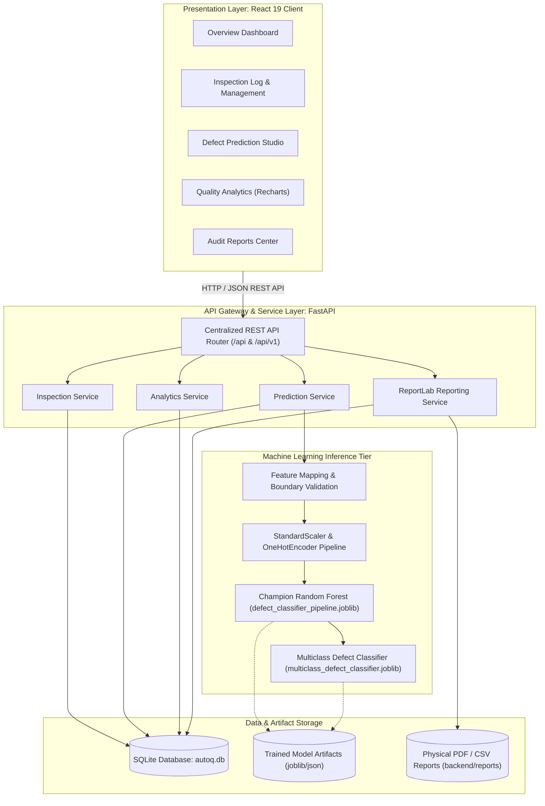
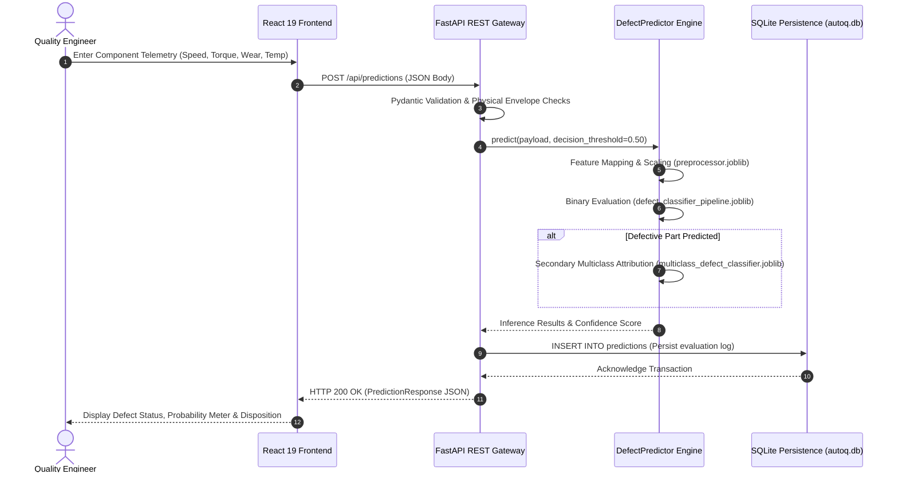
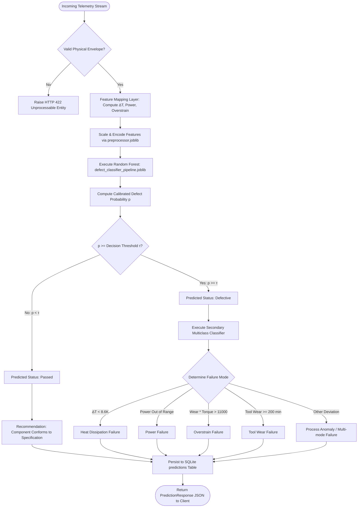
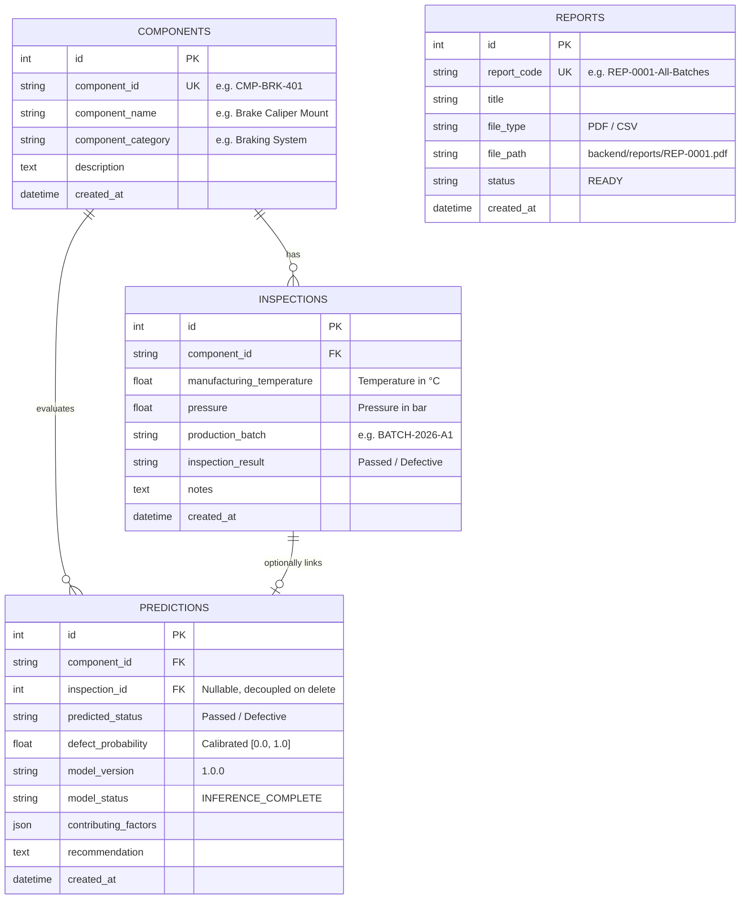
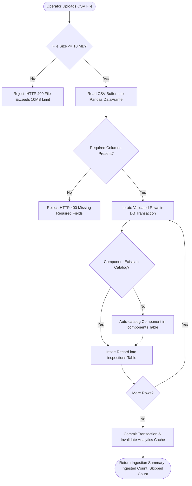
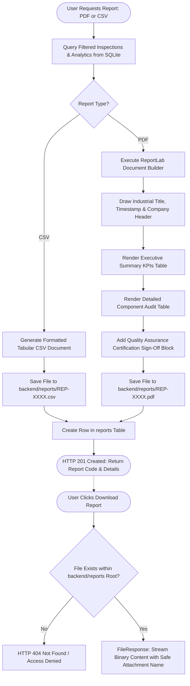

# AutoQ – Architecture and Workflow Diagrams

This directory contains the authoritative visual diagrams representing the architecture, data flows, machine learning pipelines, and relational schemas of the AutoQ Automotive Quality Intelligence System.

---

## 1. Overall System Architecture

---

## 2. Frontend-Backend Communication Flow

---

## 3. Machine Learning Training & Model Selection Pipeline

```mermaid
flowchart LR
    RawData["Raw Telemetry (AI4I 2020: 10,000 records)"]
    
    subgraph DataPrep["Zero-Leakage Partitioning"]
        Split["Stratified Split (80% Train / 20% Test)"]
        TrainSet["Train Set (8,000 rows, 280 defects)"]
        TestSet["Holdout Test Set (2,000 rows, 68 defects)"]
    end

    subgraph FeatureEng["Feature Engineering"]
        Eng1["Thermal Gradient: ΔT = T_process - T_air"]
        Eng2["Mechanical Power: P = 2π * rpm * torque / 60"]
        Eng3["Overstrain Index: Wear * Torque"]
    end

    subgraph CandidateTraining["Cross-Validation Training (5-Fold CV)"]
        LR["Logistic Regression (CV ROC: 0.9228)"]
        DT["Decision Tree (CV ROC: 0.9491)"]
        RF["Balanced Random Forest (CV ROC: 0.9801)"]
        GB["Gradient Boosting (CV ROC: 0.9795)"]
    end

    subgraph HoldoutEval["Holdout Test Evaluation (N=2,000)"]
        Eval["Model Selection: Random Forest Champion"]
        Metrics["ROC-AUC: 0.9830 | PR-AUC: 0.8737 | Recall: 86.76%"]
        Artifacts["Serialize to defect_classifier_pipeline.joblib"]
    end

    RawData --> Split
    Split --> TrainSet
    Split --> TestSet
    TrainSet --> FeatureEng
    FeatureEng --> CandidateTraining
    CandidateTraining --> HoldoutEval
```

---

## 4. Real-Time Defect Prediction & Attribution Workflow

---

## 5. Database Entity Relationship Diagram (ERD)

---

## 6. CSV Inspection Upload Workflow

---

## 7. Report Generation & Download Workflow

